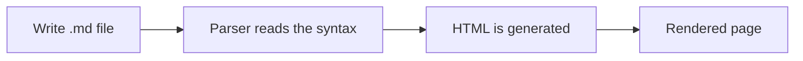

# MARKDOWN.EXE // Markdown Syntax, Explained While Using It


```text
 __  __    _    ____  _  _____   _____        ___   _
|  \/  |  / \  |  _ \| |/ /  _ \ / _ \ \      / / \ | |
| |\/| | / _ \ | |_) | ' /| | | | | | \ \ /\ / /|  \| |
| |  | |/ ___ \|  _ <| . \| |_| | |_| |\ V  V / | |\  |
|_|  |_/_/   \_\_| \_\_|\_\____/ \___/  \_/\_/  |_| \_|
              [ session started. parser online. ]
```

*Written by: **Arpit** | Course: PowerShell Scripting | Lab 4*

A `.md` file is a plain text file. A program called a **parser** reads the special symbols in it and turns them into a formatted page, so `#` becomes a heading and `**text**` becomes bold. As a cybersecurity student I like this because it is fast, it works in any editor, and the raw file stays readable.

This guide covers the Markdown syntax I learned. Each section explains a feature and then uses it right there, so the file demonstrates itself. The theme is dark and terminal-style: neon badges, an ASCII banner, and security-flavored examples.

> [!NOTE]
> A Markdown file cannot force a dark background, because the viewer decides that. The cyberpunk look here comes from the badges, the banner, the code blocks, and the examples.

---

## Table of Contents

1. [Headings](#1-headings)
2. [Text styling](#2-text-styling)
3. [Lists](#3-lists)
4. [Links](#4-links)
5. [Images](#5-images)
6. [Blockquotes and alerts](#6-blockquotes-and-alerts)
7. [Code](#7-code)
8. [Tables](#8-tables)
9. [Horizontal rules, line breaks and escapes](#9-horizontal-rules-line-breaks-and-escapes)
10. [Extra features](#10-extra-features)

---

## 1. Headings

A heading starts with `#` characters followed by a space. One `#` is the biggest heading and six `#` is the smallest, and I think of it like privilege levels: the fewer the `#`, the more important the heading.

# Level 1: root
## Level 2: admin
### Level 3: standard user
#### Level 4: guest
##### Level 5: restricted
###### Level 6: sandboxed

I leave a blank line before and after every heading. Some parsers will not recognize a heading that is stuck to the paragraph above it.

---

## 2. Text styling

Wrapping text in symbols changes how it looks. Here is each one, used in a sentence that explains it:

- Two asterisks make text **bold**, which I use for warnings like **never reuse passwords**.
- One asterisk makes text *italic*, which I use to stress a word, like a firewall is *not* an antivirus.
- Three asterisks do both, so ***Zero Trust*** is bold and italic.
- Two tildes cross text out, so ~~passwords do not need MFA~~ is clearly wrong.
- Backticks make `inline code`, which I use for commands like `whoami` so they stand out from normal text.

---

## 3. Lists

Lists group related items. There are three kinds.

**Unordered lists** use a dash. Indenting an item two spaces nests it under the one above, and I use it here for a recon workflow:

- Reconnaissance
  - Passive information gathering
  - Active scanning
    - Port scanning (only on my own lab VMs)
- Analysis
- Reporting

**Ordered lists** use numbers. The parser numbers them automatically, so I use them when the order matters, like a lab procedure:

1. Start the lab VM
2. Take a snapshot
3. Change one setting
4. Test the result
5. Document it

**Task lists** use `- [ ]` for open items and `- [x]` for finished ones, so I use them as a progress checklist:

- [x] Headings
- [x] Text styling
- [x] Lists
- [ ] Review the whole file

---

## 4. Links

A link has the text in square brackets followed by the address in parentheses. There are a few styles, and I list each below using the style it describes:

- **Inline link:** [The Markdown Guide](https://www.markdownguide.org/)
- **Link with a hover title:** [GitHub Docs](https://docs.github.com "hover text goes here")
- **Automatic link:** <https://www.markdownguide.org/cheat-sheet/> (the address in angle brackets becomes clickable on its own)
- **Reference-style link:** here is the [PowerShell Gallery][psgallery]. The address is defined once at the bottom of this section, which keeps long URLs out of the sentence.
- **Internal link:** this one jumps back to the [Headings](#1-headings) section by using `#` plus the heading text in lowercase with dashes.

[psgallery]: https://www.powershellgallery.com/

---

## 5. Images

An image uses the same format as a link with an exclamation mark in front: ``. The alt text is shown if the image fails to load, and screen readers read it aloud, so it should describe the image. The badges at the top of this file are images loaded from a web address, and here is one more:


---

## 6. Blockquotes and alerts

A blockquote starts a line with `>`. I use it for quotes, definitions, and important notes:

> The weakest link decides how secure the whole system is.

Adding more `>` nests a quote inside another quote:

> Outer quote.
>
> > Inner quote, one level deeper.

GitHub also supports **alerts**, which are blockquotes with a keyword on the first line. They show up as colored boxes:

> [!TIP]
> Turn on MFA for every account that supports it.

> [!WARNING]
> Only scan or test systems that I own or have written permission to test.

---

## 7. Code

Inline code uses one backtick on each side, like `Get-Process`. A **fenced code block** uses three backticks before and after, and the word after the opening fence tells the renderer which language to color. Each block below is a short security-flavored example:

```powershell
# List running processes, sorted by CPU, top five
Get-Process | Sort-Object CPU -Descending | Select-Object -First 5
```

```bash
# Scan my own lab VM for open ports and service versions
nmap -sV 192.168.56.10
```

```python
# How many possible 8-character passwords from a-z, A-Z and 0-9?
charset_size = 26 + 26 + 10
print(charset_size ** 8)
```

The `diff` language colors lines starting with `-` red and `+` green, so it is a clean way to show a config change:

```diff
- PasswordAuthentication yes
+ PasswordAuthentication no
+ PubkeyAuthentication yes
```

---

## 8. Tables

A table uses `|` to separate columns, and a second row of dashes marks the header. Here is one defining some core security terms:

| Term            | Meaning                                   | Example                     |
| --------------- | ----------------------------------------- | --------------------------- |
| Least privilege | Only give the access that is needed       | Standard users are not admins |
| MFA             | Two or more proofs of identity            | Password plus an app code   |
| Zero Trust      | Verify every request, trust nothing       | Re-check identity each time |
| Hashing         | One-way digest of data                    | SHA-256 of a file           |

Colons in the dash row control alignment: `:---` is left, `:---:` is centered, and `---:` is right. This table shows all three using common ports:

| Port (left) | Service (centered) | Protocol (right) |
| :---------- | :----------------: | ---------------: |
| 22          |        SSH         |              TCP |
| 80          |        HTTP        |              TCP |
| 443         |       HTTPS        |              TCP |

---

## 9. Horizontal rules, line breaks and escapes

**Horizontal rules** are made with three dashes, asterisks, or underscores on their own line. I have been using the dash version to separate sections, and the other two look like this:

***

___

**Line breaks:** pressing Enter once inside a paragraph does not start a new line in the rendered page. Ending a line with two spaces or a backslash forces one.  
This sentence is on a new line because of that.

**Escaping:** a backslash in front of a symbol stops Markdown from using it as formatting. So \*this is not italic\* and \# this is not a heading, even though they contain the same symbols.

---

## 10. Extra features

Some extra syntax I picked up, each used where it is explained:

- **Keyboard keys:** the `<kbd>` tag draws a key, so open the preview in VSCodium with <kbd>Ctrl</kbd> + <kbd>Shift</kbd> + <kbd>V</kbd>.
- **Subscript and superscript:** `<sub>` and `<sup>` give H<sub>2</sub>O and 2<sup>10</sup> = 1024.
- **Math:** text between dollar signs is rendered as math. For example, password entropy is $H = L \log_2 N$, where $L$ is the length and $N$ is the character set size.
- **Footnotes:** a marker like `[^1]` links to a note at the bottom of the file, like this one about Markdown's history.[^1]
- **Comments:** text inside `<!-- -->` is hidden when rendered but stays in the raw file. <!-- this comment is only visible in the source -->

A **collapsible section** uses the `<details>` tag. It is useful for hiding long output until the reader wants it:

<details>
<summary>Click to expand</summary>

This content was hidden until now. I would use this for long command output so it does not fill the page.

</details>

**Mermaid diagrams** are written in a code block with the language `mermaid` and drawn automatically. This one shows how a Markdown file becomes a page:



[^1]: Markdown was created by John Gruber in 2004, with help from Aaron Swartz.

---

## Final checklist

- [x] Headings, text styling, and lists
- [x] Links, images, and blockquotes
- [x] Code, tables, and horizontal rules
- [x] Line breaks, escapes, and extra features

```text
[ session closed. stay curious, stay legal. ]
```
